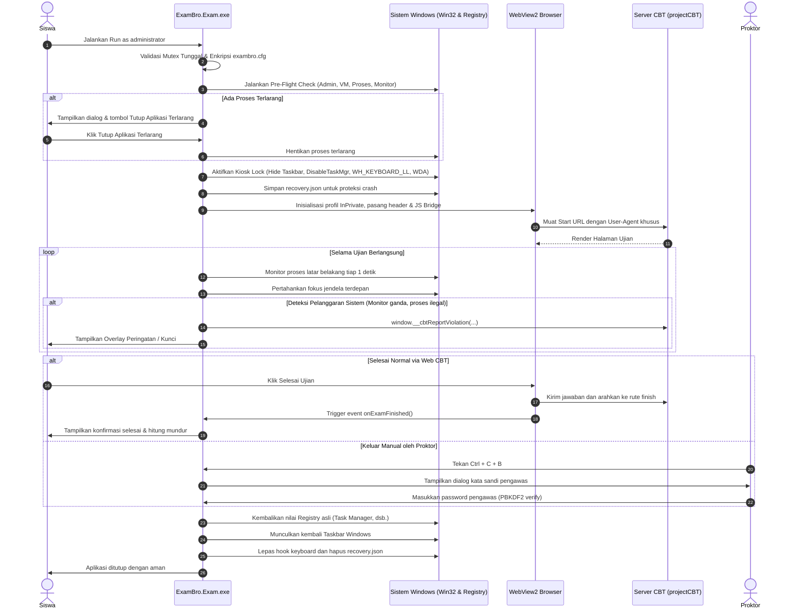

# WinVox ExamBro

Peramban ujian aman berbasis WPF dan Microsoft Edge WebView2 untuk mengunci lingkungan desktop Windows 10 dan Windows 11 selama pelaksanaan ujian berbasis komputer (CBT / Computer-Based Testing).

Aplikasi ini mengisolasi workstation peserta, memblokir shortcut keyboard berbahaya, menonaktifkan perpindahan jendela, mencegah perekaman layar, dan berkomunikasi langsung dengan server ujian lokal maupun berbasis web seperti projectCBT.

---

## Daftar Isi

1. [Fitur Utama](#fitur-utama)
2. [Arsitektur Sistem](#arsitektur-sistem)
3. [Alur Kerja Aplikasi](#alur-kerja-aplikasi)
4. [Struktur Repositori](#struktur-repositori)
5. [Prasyarat Sistem](#prasyarat-sistem)
6. [Panduan Build dan Kompilasi](#panduan-build-dan-kompilasi)
7. [Tutorial Deployment](#tutorial-deployment)
   - [Metode 1: Mode Portable](#metode-1-mode-portable-disarankan)
   - [Metode 2: Installer Inno Setup](#metode-2-installer-inno-setup)
   - [Distribusi Massal di Laboratorium Komputer](#distribusi-massal-di-laboratorium-komputer)
8. [Panduan Penggunaan Siswa](#panduan-penggunaan-siswa)
9. [Panduan Pengaturan Proktor dan Administrator](#panduan-pengaturan-proktor-dan-administrator)
10. [Integrasi dengan projectCBT](#integrasi-dengan-projectcbt)
11. [Mekanisme Keamanan dan Hardening](#mekanisme-keamanan-dan-hardening)
12. [Ketahanan Sistem dan Pemulihan Pasca Gangguan](#ketahanan-sistem-dan-pemulihan-pasca-gangguan)
13. [Pemecahan Masalah](#pemecahan-masalah)
14. [Referensi Cepat dan Nilai Bawaan](#referensi-cepat-dan-nilai-bawaan)

---

## Fitur Utama

- **Penguncian Kiosk Penuh**: Jendela maximized borderless yang menutupi taskbar Windows di seluruh monitor aktif dan dipatok pada status Topmost.
- **Pemblokiran Keyboard Tingkat Rendah**: P/Invoke hook `WH_KEYBOARD_LL` memblokir tombol Windows, Alt+Tab, Alt+Esc, Ctrl+Esc, Alt+F4, Ctrl+Shift+Esc, PrintScreen, Menu Apps, dan shortcut browser.
- **Penyaringan Kernel dan Penanganan SAS**: Mencegah interupsi Ctrl+Alt+Del menggunakan Keyboard Filter (WEKF) pada edisi Windows yang mendukung, serta pemulihan fokus aktif secara instan jika layar keamanan Winlogon muncul.
- **Penjaga Fokus Aktif**: WinEvent hook `EVENT_SYSTEM_FOREGROUND` dan `AttachThreadInput` segera merebut kembali fokus jika ada jendela asing yang mencoba tampil ke latar depan.
- **Anti Screenshot dan Anti Rekam Layar**: Memanfaatkan Windows API hardware-level `SetWindowDisplayAffinity` (`WDA_EXCLUDEFROMCAPTURE`), membuat hasil tangkapan layar dan rekaman aplikasi seperti OBS, Snipping Tool, atau Discord menjadi hitam pekat.
- **Hardening WebView2**: Profil browser terisolasi, DevTools dimatikan, klik kanan dinonaktifkan, tombol akselerator peramban dinonaktifkan, download diblokir otomatis, dan sertifikat HTTPS lokal self-signed dilewati tanpa menampilkan layar peringatan merah.
- **Whitelisting Navigasi**: Akses hanya diizinkan untuk pola URL yang telah didaftarkan. Skema berisiko seperti `file:`, `javascript:`, `view-source:`, dan `ftp:` diblokir langsung.
- **Pemindai Proses Terlarang**: Monitor latar belakang memindai proses terlarang (browser umum, alat remote desktop, cheat tool, sniffer paket) setiap 1 detik dengan pengecualian otomatis untuk proses pembantu internal WebView2.
- **Tutup Aplikasi 1 Klik**: Layar pra-ujian mendeteksi proses terlarang dan menyediakan tombol untuk mematikan semua proses tersebut sekaligus sebelum ujian dimulai.
- **Penguncian Registry Pengguna**: Menetapkan kebijakan HKCU sementara untuk menonaktifkan Task Manager, Lock Workstation, Change Password, dan opsi Logoff. Seluruh nilai registri asli dicatat dan dikembalikan saat aplikasi ditutup.
- **Dua Arah dengan projectCBT**: Mendukung bridge JavaScript `window.LouisVoxExamApp`, pelaporan insiden native ke log server, penyerahan ujian otomatis saat mencapai rute finish, dan pembukaan kunci jarak jauh (Remote Unlock) dari dashboard pengawas.
- **Dua Format Distribusi**: Berjalan langsung tanpa instalasi (Portable single-file) atau dipasang melalui berkas instalasi MSI / Inno Setup.

---

## Arsitektur Sistem

WinVox ExamBro dibangun dengan arsitektur modular .NET 8 menggunakan pola WPF MVVM dan enkripsi terpadu:

```mermaid
flowchart TD
    subgraph UI_Layer["Lapisan Antarmuka (WPF .NET 8)"]
        ExamClient["ExamBro.Exam.exe (Klien Kiosk)"]
        ConfigClient["ExamBro.Config.exe (Panel Admin)"]
        PreFlight["Pemeriksaan Pra-Ujian"]
        Overlay["Overlay Peringatan & Kunci"]
    end

    subgraph Security_Layer["Lapisan Keamanan & Hooking Win32"]
        KeyHook["WH_KEYBOARD_LL (Hook Keyboard)"]
        FocusGuard["Focus Guard (WinEvent Foreground)"]
        DispAffinity["SetWindowDisplayAffinity (Anti-Capture)"]
        ProcMonitor["Scanner Proses Latar Belakang (1 detik)"]
        PolicyReg["Registry Policies (DisableTaskMgr, dll.)"]
        SASDismiss["Pencegah Interupsi SAS / Winlogon"]
    end

    subgraph Engine_Layer["Lapisan Peramban (WebView2)"]
        WV2["Microsoft Edge WebView2 Runtime"]
        JSBridge["Bridge JavaScript (window.LouisVoxExamApp)"]
        NavFilter["Filter Navigasi & Whitelist URL"]
        SSLExempt["Auto Bypass Sertifikat HTTPS Lokal"]
    end

    subgraph Core_Layer["Pustaka Inti (ExamBro.Core)"]
        Crypto["AES-256-GCM + DPAPI"]
        Hasher["PBKDF2-HMAC-SHA256 (310.000 iterasi)"]
        ConfigStore["exambro.cfg (Enkripsi Mandiri)"]
        Recovery["recovery.json (Pemulihan Crash)"]
    end

    subgraph Server_Layer["Server Ujian Komputer"]
        CBTServer["projectCBT / Web Server Sekolah (Port 8008 / 80 / 443)"]
    end

    ExamClient --> PreFlight
    PreFlight --> ExamClient
    ExamClient --> KeyHook
    ExamClient --> FocusGuard
    ExamClient --> DispAffinity
    ExamClient --> ProcMonitor
    ExamClient --> PolicyReg
    ExamClient --> SASDismiss

    ExamClient --> WV2
    WV2 --> JSBridge
    WV2 --> NavFilter
    WV2 --> SSLExempt

    ConfigClient --> Crypto
    ConfigClient --> Hasher
    ConfigClient --> ConfigStore

    ExamClient --> Crypto
    ExamClient --> ConfigStore
    ExamClient --> Recovery

    WV2 <-->|HTTP / WebSocket / Custom Headers| CBTServer
    JSBridge <-->|Sinkronisasi Status & Pelanggaran| CBTServer
```



---

## Alur Kerja Aplikasi

Diagram berikut menunjukkan siklus hidup jalannya ujian dari persiapan pra-terbang hingga sistem dipulihkan:



---

## Struktur Repositori

```
WinVoxExamBro/
├── Directory.Build.props                  # Konfigurasi build global (.NET 8, C# latest, Nullable)
├── ExamBro.sln                            # Berkas solusi Visual Studio
├── push_to_github.sh                      # Skrip helper otomatisasi pengujian, commit, dan push
├── PETUNJUK_PENGGUNAAN_DAN_INSTALASI.txt  # Dokumentasi teks operasional lapangan
├── README.md                              # Dokumentasi teknis, arsitektur, dan panduan lengkap
│
├── src/
│   ├── ExamBro.Core/                      # Pustaka logika inti dan kriptografi
│   │   ├── Constants.cs                   # Definisi konstanta global, path, dan header
│   │   ├── Models/
│   │   │   └── ExamConfig.cs              # Skema konfigurasi dan enumerasi aturan
│   │   ├── Security/
│   │   │   ├── ConfigEncryption.cs        # Enkripsi AES-256-GCM, DPAPI, dan ekspor .exbcfg
│   │   │   └── PasswordHasher.cs          # Hashing kata sandi PBKDF2-HMAC-SHA256
│   │   ├── Validation/
│   │   │   ├── UrlMatcher.cs              # Pemcocokan wildcard URL dan blokir skema
│   │   │   └── ConfigValidator.cs         # Validasi keabsahan data konfigurasi
│   │   ├── Logging/
│   │   │   ├── LoggerSetup.cs             # Inisialisasi Serilog rolling file logger
│   │   │   └── WebhookSink.cs             # Pengiriman log via webhook HTTPS dengan tanda tangan HMAC
│   │   └── Recovery/
│   │       └── RecoveryState.cs           # Serialisasi status pemulihan crash
│   │
│   ├── ExamBro.Exam/                      # Aplikasi Kiosk Browser Ujian (WPF .NET 8)
│   │   ├── app.manifest                   # Elevasi hak akses Administrator (requireAdministrator)
│   │   ├── App.xaml / App.xaml.cs         # Titik masuk, deteksi mutex, inisialisasi pemulihan
│   │   ├── Services/
│   │   │   ├── KioskLockService.cs        # Win32 taskbar hide, HKCU registry, dan tombol aksesibilitas
│   │   │   ├── KeyboardHookService.cs     # Low-level hook WH_KEYBOARD_LL dan filter WEKF
│   │   │   ├── FocusGuardService.cs       # Penjaga jendela terdepan menggunakan WinEvent hook
│   │   │   ├── ClipboardService.cs        # Pembersihan dan pemantauan format clipboard
│   │   │   ├── ProcessMonitorService.cs   # Pemindai proses blacklist setiap 1 detik
│   │   │   ├── EnvironmentDetector.cs     # Deteksi Virtual Machine, RDP, debugger, dan monitor
│   │   │   ├── ScreenProtectionService.cs # SetWindowDisplayAffinity dan overlay monitor sekunder
│   │   │   └── ViolationManager.cs        # Manajemen dan eskalasi strike pelanggaran
│   │   ├── ViewModels/
│   │   │   ├── ExamViewModel.cs           # State peramban, toolbar, jam, baterai, dan koneksi
│   │   │   └── PreFlightViewModel.cs      # State verifikasi kesiapan sistem pra-ujian
│   │   └── Views/
│   │       ├── ExamWindow.xaml (.cs)      # Jendela utama browser kiosk dengan integrasi WebView2
│   │       ├── PreFlightDialog.xaml (.cs) # Dialog diagnosa pra-terbang dan tombol tutup aplikasi
│   │       ├── WarningOverlay.xaml (.cs)  # Overlay visual peringatan sementara
│   │       ├── LockScreen.xaml (.cs)      # Layar penguncian ujian dengan validasi password
│   │       ├── ExitDialog.xaml (.cs)      # Dialog konfirmasi keluar pengawas
│   │       └── SecondaryScreenOverlayWindow.xaml (.cs) # Penutup layar hitam monitor sekunder
│   │
│   └── ExamBro.Config/                    # Panel Konfigurasi Administrator (WPF .NET 8)
│       ├── app.manifest                   # Elevasi hak akses Administrator (requireAdministrator)
│       ├── App.xaml / App.xaml.cs         # Inisialisasi wizard awal dan verifikasi login admin
│       ├── ViewModels/
│       │   ├── MainViewModel.cs           # Logika manajemen 6 tab pengaturan, simpan, ekspor/impor
│       │   └── ViolationRuleItemViewModel.cs
│       └── Views/
│           ├── MainWindow.xaml (.cs)      # Antarmuka panel konfigurasi
│           ├── SetupWizardDialog.xaml (.cs) # Wisaya pemandu konfigurasi awal
│           ├── LoginDialog.xaml (.cs)     # Dialog autentikasi admin dengan perlindungan brute-force
│           ├── TestUrlWindow.xaml (.cs)   # Jendela uji koneksi ke Start URL non-kiosk
│           └── ChangePasswordDialog.xaml (.cs) # Dialog penggantian password admin dan pengawas
│
├── tests/
│   └── ExamBro.Tests/                     # Paket Pengujian Unit (xUnit .NET 8)
│       ├── ConfigValidatorTests.cs        # 107 pengujian integritas konfigurasi
│       ├── PasswordHasherTests.cs         # Pengujian keandalan PBKDF2 dan constant-time verify
│       ├── ConfigEncryptionTests.cs      # Pengujian AES-256-GCM dan proteksi tamper
│       └── UrlMatcherTests.cs             # Pengujian wildcard URL dan pemblokiran skema
│
├── installer/
│   └── setup.iss                          # Skrip kompilasi installer Inno Setup (x64)
│
└── .github/
    └── workflows/
        └── ci-cd.yml                      # Alur kerja build, test, packaging, dan release otomatis
```

---

## Prasyarat Sistem

### Lingkungan Eksekusi Klien Ujian
- **Sistem Operasi**: Windows 10 (versi 1809 atau lebih baru) atau Windows 11 (arsitektur 64-bit / x64).
- **Hak Akses**: Hak Administrator lokal (UAC elevation diperlukan untuk Win32 hooks dan kebijakan registri).
- **WebView2 Runtime**: Microsoft Edge WebView2 Evergreen Runtime. Pada Windows 10 dan 11 versi modern, komponen ini telah terpasang secara bawaan.
- **Runtime .NET**: Tidak memerlukan instalasi runtime .NET tambahan jika mendistribusikan berkas rilis berjenis *self-contained single-file*.

### Lingkungan Pengembangan dan Build
- **SDK**: .NET SDK 8.0.x (mendukung Windows Desktop Workload untuk WPF).
- **Sistem Operasi**: Windows 10/11 x64 (untuk kompilasi Inno Setup dan eksekusi WPF penuh), atau Linux/macOS dengan .NET 8 SDK (untuk kompilasi pustaka ExamBro.Core dan eksekusi unit test).
- **Compiler Installer**: Inno Setup versi 6.x (jika ingin membangun berkas installer tunggal `.exe`).

---

## Panduan Build dan Kompilasi

### 1. Menjalankan Pengujian Unit

Jalankan perintah berikut untuk memastikan seluruh logika kriptografi, validasi konfigurasi, dan pencocokan URL berjalan normal:

```bash
# Mengembalikan dependensi paket NuGet
dotnet restore ExamBro.sln

# Menjalankan seluruh pengujian unit
dotnet test tests/ExamBro.Tests/ExamBro.Tests.csproj -c Release
```

### 2. Kompilasi Executable Mandiri (Self-Contained Single-File)

Gunakan perintah build berikut untuk menghasilkan berkas executable mandiri berarsitektur `win-x64`. Mode ini membundel seluruh pustaka runtime .NET ke dalam satu berkas `.exe`:

```powershell
# 1. Kompilasi ExamBro Kiosk Client
dotnet publish src/ExamBro.Exam/ExamBro.Exam.csproj `
  -c Release `
  -r win-x64 `
  --self-contained true `
  -p:PublishSingleFile=true `
  -p:IncludeNativeLibrariesForSelfExtract=true `
  -o dist/ExamBro.Exam

# 2. Kompilasi ExamBro Config Tool
dotnet publish src/ExamBro.Config/ExamBro.Config.csproj `
  -c Release `
  -r win-x64 `
  --self-contained true `
  -p:PublishSingleFile=true `
  -p:IncludeNativeLibrariesForSelfExtract=true `
  -o dist/ExamBro.Config
```

Hasil kompilasi akan berada di:
- `dist/ExamBro.Exam/ExamBro.Exam.exe` (Ukuran sekitar 157 MB, mandiri)
- `dist/ExamBro.Config/ExamBro.Config.exe` (Ukuran sekitar 157 MB, mandiri)

### 3. Kompilasi Installer Inno Setup

Jika Anda memerlukan berkas instalasi formal:

```cmd
"C:\Program Files (x86)\Inno Setup 6\iscc.exe" installer\setup.iss
```

Berkas installer akhir akan tersimpan di direktori `dist/installer/`.

---

## Tutorial Deployment

### Metode 1: Mode Portable (Disarankan)

Mode portable adalah cara tercepat untuk mempersiapkan komputer ujian di sekolah tanpa perlu menyentuh instalasi sistem Windows.

1. Siapkan folder portable yang berisi berkas:
   - `ExamBro.Exam.exe` (program peramban siswa)
   - `ExamBro.Config.exe` (program pengaturan proktor)
   - `exambro.cfg` (berkas konfigurasi terenkripsi)
2. Buka `ExamBro.Config.exe` pada satu komputer proktor untuk menentukan Start URL server sekolah, whitelist, dan kata sandi.
3. Klik tombol Simpan Portable pada tab Admin. Berkas `exambro.cfg` mandiri akan dibuat di folder yang sama.
4. Salin seluruh isi folder tersebut ke flashdisk atau bagikan melalui shared folder jaringan lokal (LAN).
5. Pada komputer siswa, salin folder ke drive lokal (misalnya `D:\ExamBro\` atau Desktop) dan jalankan `ExamBro.Exam.exe`.

### Metode 2: Installer Inno Setup

Metode ini cocok untuk laboratorium komputer sekolah yang menggunakan citra sistem terpusat atau software deployment manager.

1. Jalankan berkas installer `ExamBro-Setup-v1.0.0.exe` dengan hak Administrator.
2. Program akan terpasang di folder `C:\Program Files\ExamBro\`.
3. Installer secara otomatis membuat direktori data terproteksi di `C:\ProgramData\ExamBro\` dengan hak akses (ACL) yang aman:
   - Akun siswa (Users) memiliki izin Read dan Execute.
   - Akun proktor (Administrators) memiliki izin Full Control.
4. Pintasan aplikasi akan otomatis tersedia di Desktop dan Start Menu siswa.

### Distribusi Massal di Laboratorium Komputer

Untuk menerapkan konfigurasi yang sama ke puluhan atau ratusan komputer klien secara serentak:

```
[Komputer Proktor / Server]
           │
           │  1. Simpan exambro.cfg menggunakan ExamBro.Config.exe
           ▼
   [exambro.cfg]
           │
           ├────────────────────────┬────────────────────────┐
           ▼                        ▼                        ▼
    [PC Klien Lab 01]        [PC Klien Lab 02]        [PC Klien Lab N]
    Salin ke folder          Salin ke folder          Salin ke folder
    aplikasi / ProgramData   aplikasi / ProgramData   aplikasi / ProgramData
```

Langkah operasional:
1. Konfigurasikan seluruh aturan ujian pada satu komputer menggunakan `ExamBro.Config.exe`.
2. Salin berkas `exambro.cfg` yang dihasilkan.
3. Tempelkan berkas tersebut ke komputer siswa pada lokasi target:
   - Jika menggunakan mode portable: Letakkan di satu folder yang sama dengan `ExamBro.Exam.exe`.
   - Jika menggunakan installer: Letakkan di `C:\ProgramData\ExamBro\exambro.cfg`.
4. Uji coba peluncuran pada salah satu PC siswa untuk memastikan halaman ujian langsung terbuka dengan benar.

---

## Panduan Penggunaan Siswa

### 1. Memulai Ujian
1. Klik kanan pada berkas `ExamBro.Exam.exe` lalu pilih **Run as administrator** (atau klik dua kali dan setujui prompt UAC Windows).
2. Jendela **Pemeriksaan Kesiapan Sistem** akan memeriksa integritas komputer:
   - Status hak Administrator.
   - Status lingkungan mesin virtual (jika diwajibkan perangkat fisik).
   - Status sesi Remote Desktop.
   - Pengecekan proses terlarang yang sedang aktif di latar belakang.
3. Jika terdapat proses terlarang yang sedang berjalan, klik tombol **Tutup Aplikasi Terlarang** untuk menghentikan seluruh proses tersebut secara otomatis dalam 1 klik.
4. Setelah seluruh status diagnosa menunjukkan status Lolos, klik **Mulai Ujian**. Layar akan langsung beralih ke mode kiosk layar penuh dan memuat halaman login ujian.

### 2. Selama Ujian Berlangsung
- Seluruh shortcut sistem dinonaktifkan: Tombol Windows, Alt+Tab, Alt+F4, Ctrl+Alt+Del, Ctrl+Shift+Esc, dan PrintScreen tidak dapat digunakan.
- Layar dilindungi dari perekaman. Jika ada aplikasi pihak ketiga yang mencoba merekam layar di latar belakang, hasil rekaman hanya akan berupa layar hitam pekat.
- Bekerjalah hanya pada halaman ujian yang disediakan. Jangan mencoba memasukkan tautan eksternal yang berada di luar subnet server sekolah.

### 3. Menyelesaikan Ujian
- Setelah selesai mengerjakan ujian pada sistem web CBT, klik tombol **Selesai** atau **Kirim Jawaban** di halaman web.
- Ketika web mengarahkan ke halaman rute selesai (`/exam/finished/...`), ExamBro secara otomatis mendeteksi status tersebut, memunculkan kartu informasi bahwa ujian telah selesai diserahkan, dan menutup aplikasi secara otomatis dalam beberapa detik.
- Taskbar dan seluruh fungsi sistem Windows akan langsung kembali normal.

### 4. Keluar Manual dengan Bantuan Pengawas
Jika peserta mengalami kendala teknis dan harus keluar dari aplikasi sebelum ujian selesai:
1. Panggil pengawas ujian.
2. Pengawas akan menekan kombinasi tombol `Ctrl + C + B` pada keyboard.
3. Pengawas memasukkan kata sandi pengawas yang valid pada dialog yang muncul.
4. Klik **Konfirmasi Keluar**. Aplikasi akan ditutup dan sistem dipulihkan sepenuhnya.

---

## Panduan Pengaturan Proktor dan Administrator

Jalankan `ExamBro.Config.exe` dengan hak Administrator. Masukkan kata sandi Administrator (kata sandi bawaan: `admin123`).

Panel pengaturan terdiri dari 6 bagian utama:

```
┌────────────────────────────────────────────────────────────────────────┐
│ Panel Pengaturan ExamBro                                 [Simpan] [X]  │
├───────────┬───────────┬───────────┬───────────┬───────────┬────────────┤
│ 1. Umum   │ 2. URL    │ 3. Aman   │ 4. Pantau │ 5. Akun   │ 6. Log     │
└───────────┴───────────┴───────────┴───────────┴───────────┴────────────┘
```

### Tab 1: Umum
- **Alamat URL Halaman Awal (Start URL)**: Tentukan alamat portal ujian sekolah Anda (misalnya `http://192.168.70.9` atau `http://localhost:8008`).
- **Judul Jendela dan Branding**: Ubah judul aplikasi dan pilih logo sekolah kustom (.png atau .ico). Logo akan tersimpan langsung ke dalam konfigurasi terenkripsi.
- **Uji Koneksi Start URL**: Klik tombol **Uji Start URL** di pojok kanan atas untuk memvalidasi apakah server sekolah dapat dijangkau dari workstation tanpa mengunci layar.

### Tab 2: Navigasi dan URL
- **Whitelist Pola URL**: Daftarkan subnet atau domain server ujian. Format wildcard didukung (contoh: `192.168.0.0`, `*192.168.*`, `http://192.168.*/*`).
- **Pola URL Keluar Otomatis (Exit URL)**: Tentukan URL yang memicu penutupan kiosk otomatis saat siswa selesai ujian (bawaan: `*/finished*`, `*/exam/finish*`, `*/logout*`).
- **Pengaturan Audio Web CBT**: Opsi untuk mematikan seluruh audio dari peramban (Mute Audio) atau mengatur batas volume suara (0% sampai 100%) untuk ujian listening.

### Tab 3: Kebijakan Keamanan
- **Deteksi Mesin Virtual (Anti-VM)**: Aktifkan untuk mewajibkan peserta menggunakan laptop atau PC fisik. Matikan opsi ini jika Anda ingin menguji aplikasi di VirtualBox, VMware, atau lingkungan pengujian.
- **Blokir Sesi Remote Desktop**: Menolak eksekusi aplikasi jika terdeteksi koneksi RDP, AnyDesk, atau VNC aktif.
- **Kebijakan Monitor Ganda**: Tentukan tindakan jika siswa menyambungkan monitor kedua:
  - `CoverAll`: Menampilkan penutup layar hitam pekat di seluruh monitor kedua dan seterusnya.
  - `Block`: Menolak aplikasi berjalan sampai monitor tambahan dicabut.

### Tab 4: Pemantauan Proses
- Kelola daftar hitam nama proses terlarang yang akan dipantau setiap 1 detik.
- Aplikasi bawaan Windows seperti CMD, PowerShell, dan Task Manager yang berjalan secara headless di latar belakang tanpa jendela desktop aktif dilindungi dari false positive.

### Tab 5: Akun Administrator dan Pengawas
- Ubah kata sandi login panel administrator.
- Ubah kata sandi pengawas untuk konfirmasi keluar ujian manual (`Ctrl + C + B`).
- Ubah kombinasi tombol pintasan keluar jika diperlukan.

### Tab 6: Pencatatan Log dan Pemulihan
- Konfigurasikan direktori penyimpanan berkas log Serilog harian.
- Atur webhook HTTPS untuk mengirimkan insiden pelanggaran ke server log eksternal.
- Ekspor atau impor berkas konfigurasi portabel (`.exbcfg`).

---

## Integrasi dengan projectCBT

WinVox ExamBro terintegrasi secara langsung dengan aplikasi ujian berbasis web **projectCBT** tanpa memerlukan modifikasi pada kode sumber backend:

### 1. Identifikasi Klien Ujian Resmi
Setiap permintaan HTTP dari WebView2 secara otomatis menyertakan User-Agent khusus dan header validasi:

- **User-Agent Suffix**: ` ExamBro/1.0.0 ExamBrowser/1.0.0 LouisVox/1.0.0`
- **Header Validasi**:
  - `X-Exambrowser: 1`
  - `X-Exambro: 1`
  - `X-Exam-Browser: 1`
  - `X-CBT-Browser: 1`
  - `X-ExamBro-Version: 1.0.0`

Middleware `EnsureExamBrowser` dan pemeriksaan `SiteSetting::isExamBrowser` pada projectCBT mengenali tanda ini secara langsung.

### 2. Bridge Dua Arah JavaScript (`window.LouisVoxExamApp`)
Antarmuka JavaScript disuntikkan ke dalam dokumen web sebelum halaman dimuat:

```javascript
// Antarmuka yang disediakan oleh WinVox ExamBro untuk web CBT:
window.LouisVoxExamApp = {
    // Menerima sinkronisasi kuota strike pelanggaran dari web
    onWebExamConfig: function(maxStrikes, strikes, isLocked) {},

    // Menerima pencatatan pelanggaran dari web anti-cheat
    onWebViolationRecorded: function(type, strikes, maxStrikes, message, isLocked) {},

    // Memeriksa apakah dialog password atau overlay peringatan sedang aktif
    isAlarmOverlayActive: function() {},

    // Membuka kunci ujian peserta secara instan saat proktor menekan unlock di web
    onWebSessionUnlocked: function(strikes) {},

    // Mendeteksi pengiriman lembar jawaban dan menutup kiosk secara elegan
    onExamFinished: function() {}
};
```

### 3. Pencegahan Alarm Palsu (Zero False Positive)
- **Deteksi Layar Penuh**: ExamBro berjalan dengan status maximized tanpa border, sehingga lolos dari pemeriksaan `enforce_fullscreen` projectCBT tanpa memunculkan modal gerbang fullscreen.
- **Deteksi Split Screen**: Rasio jendela ExamBro terhadap resolusi monitor fisik bernilai penuh (`innerW/screenW = 1.0`), melewati batas toleransi split-screen.
- **Supresi Blur Fokus**: Ketika pengawas mengetikkan kata sandi pada dialog keluar, flag `window.__louisvox_suppress_blur` aktif sehingga halaman web tidak mencatat penalti kehilangan fokus terhadap siswa.

---

## Mekanisme Keamanan dan Hardening

### 1. Kiosk Lock dan Win32 Interop
- **Penyembunyian Taskbar**: Memanggil `FindWindow("Shell_TrayWnd", null)` dan `FindWindow("Shell_SecondaryTrayWnd", null)`, kemudian mengeksekusi `ShowWindow(hWnd, SW_HIDE)`.
- **Keyboard Hook**: `SetWindowsHookEx(WH_KEYBOARD_LL, ...)` dengan delegate statis yang di-pin di memori untuk mencegah pengumpulan sampah memori (Garbage Collection). Seluruh penekanan tombol sistem dipotong pada tingkat antrean pesan sebelum didistribusikan ke aplikasi.
- **Display Affinity**: `SetWindowDisplayAffinity(hWnd, WDA_EXCLUDEFROMCAPTURE)` melindungi konten soal agar tidak dapat direkam oleh tool capture hardware maupun software.

### 2. Kebijakan Registry Pengguna (HKCU)
Saat ujian berlangsung, nilai berikut diterapkan pada registry sesi aktif:
- `HKCU\Software\Microsoft\Windows\CurrentVersion\Policies\System`
  - `DisableTaskMgr = 1`
  - `DisableLockWorkstation = 1`
  - `DisableChangePassword = 1`
- `HKCU\Software\Microsoft\Windows\CurrentVersion\Policies\Explorer`
  - `NoLogoff = 1`

Nilai konfigurasi awal dicatat sebelum ditimpa, dan dipulihkan kembali saat aplikasi ditutup normal maupun tidak normal.

### 3. Isolasi Peramban WebView2
- Menggunakan direktori data pengguna khusus di `%LocalAppData%\LouisVox ExamBro\WebView2Profile`.
- Cache, cookie, dan berkas penyimpanan sesi dibersihkan saat sesi dimulai dan diakhiri.
- Menonaktifkan fitur autofill password, menu klik kanan, DevTools (F12), dan shortcut akselerator peramban.

---

## Ketahanan Sistem dan Pemulihan Pasca Gangguan

Aplikasi ini dilengkapi arsitektur ketahanan operasional untuk mengantisipasi insiden mati listrik mendadak, workstation mati paksa, atau crash:

```
[Gangguan Listrik Padam / Crash Workstation]
                   │
                   ▼
     [Komputer Dihidupkan Kembali]
                   │
         ┌─────────┴─────────┐
         ▼                   ▼
[Opsi A: Buka ExamBro]   [Opsi B: Perintah Manual]
Membaca recovery.json    Jalankan dari CMD:
dan otomatis memulihkan  ExamBro.Exam.exe --restore
taskbar serta registri
```

### 1. Penanganan Abandoned Mutex
Jika sistem mati mendadak saat mutex tunggal masih tertahan, sistem penanganan mutex mendeteksi kondisi abandoned mutex dan langsung mengambil alih kepemilikan tanpa memunculkan pesan error bentrok instance.

### 2. Pembersihan File Kunci Chromium
Chromium dan WebView2 meninggalkan berkas `SingletonLock` ketika proses dihentikan paksa. ExamBro secara proaktif mendeteksi dan menghapus berkas lock tersebut sebelum menginisialisasi peramban, serta menambahkan flag engine `--disable-session-crashed-bubble` agar siswa tidak melihat dialog pemulihan tab.

### 3. Perintah Pemulihan Manual (`--restore`)
Jika komputer tidak sempat keluar secara normal dan taskbar belum kembali terlihat, buka Command Prompt sebagai Administrator dan jalankan:

```cmd
# Untuk versi instalasi
"C:\Program Files\ExamBro\ExamBro.Exam.exe" --restore

# Untuk versi portable
ExamBro.Exam.exe --restore
```

Perintah ini akan membaca status dari `%LocalAppData%\LouisVox ExamBro\recovery.json`, mengembalikan Task Manager dan taskbar ke kondisi normal, lalu langsung keluar.

### 4. Mode Pengembangan Aman (`--dev-safe`)
Untuk menguji antarmuka dan integrasi web tanpa mengunci workstation developer:

```cmd
ExamBro.Exam.exe --dev-safe
```

Atau setel variabel lingkungan `EXAMBRO_DEV=1`. Pada mode ini, hook keyboard dan penyembunyian taskbar dinonaktifkan, sementara logika peramban, bridge, dan validasi URL tetap berjalan aktif. Mode ini secara otomatis ditolak pada build rilis kecuali jika diizinkan oleh administrator.

---

## Pemecahan Masalah

### Taskbar tidak muncul setelah komputer mati mendadak
Jalankan perintah pemulihan darurat dari Command Prompt Administrator:
```cmd
ExamBro.Exam.exe --restore
```
Taskbar Windows dan akses Task Manager akan langsung dipulihkan seketika.

### Muncul pesan bahwa konfigurasi tidak ditemukan atau tidak valid
Pastikan berkas `exambro.cfg` berada di dalam folder yang sama dengan `ExamBro.Exam.exe` (untuk mode portable), atau berada di `C:\ProgramData\ExamBro\exambro.cfg` (untuk mode installer). Jika berkas hilang, buka `ExamBro.Config.exe` untuk membuat konfigurasi baru.

### Muncul pesan peringatan hak akses Administrator
ExamBro membutuhkan hak akses Administrator untuk memasang hook keyboard sistem dan mengatur kebijakan registri. Klik kanan pada aplikasi dan pilih **Run as administrator**.

### Halaman web ujian tidak dapat diakses
1. Pastikan kabel jaringan LAN atau koneksi Wi-Fi ke server ujian telah terhubung.
2. Periksa apakah IP server lokal dapat di-ping dari komputer klien.
3. Pastikan Start URL pada `ExamBro.Config.exe` telah disetel ke alamat yang benar (contoh: `http://192.168.70.9` atau port `8008`).
4. Pastikan subnet server telah didaftarkan pada Whitelist URL.

### Muncul peringatan mesin virtual saat membuka aplikasi
Jika komputer klien menggunakan lingkungan virtual untuk pengujian atau memiliki fitur Hyper-V aktif, buka `ExamBro.Config.exe` -> Tab **Keamanan**, lalu hilangkan tanda centang pada opsi **Verifikasi Perangkat Fisik (Deteksi & Blokir Mesin Virtual)**.

---

## Referensi Cepat dan Nilai Bawaan

| Parameter | Nilai Bawaan | Keterangan |
| :--- | :--- | :--- |
| **Kata Sandi Administrator** | `admin123` | Akses masuk aplikasi `ExamBro.Config.exe` |
| **Kata Sandi Pengawas** | `proctor123` | Konfirmasi keluar manual dan buka layar kunci |
| **Pintasan Keluar Manual** | `Ctrl + C + B` | Tekan tombol C lalu B sambil menahan tombol Ctrl |
| **Start URL Bawaan** | `http://192.168.70.9` | Alamat halaman utama ujian |
| **Port Default projectCBT** | `8008` | Port standar server CBT lokal |
| **Penyimpanan Konfigurasi** | `exambro.cfg` | Terenkripsi AES-256-GCM mandiri |
| **File Status Pemulihan** | `%LocalAppData%\LouisVox ExamBro\recovery.json` | Rekaman status crash recovery |
| **Direktori Data WebView2** | `%LocalAppData%\LouisVox ExamBro\WebView2Profile` | Profil browser InPrivate terisolasi |
| **Toleransi Brute-Force** | 5 kali salah | Sistem terkunci selama 30 detik |
| **Interval Monitor Proses** | 1 detik | Pengecekan proses terlarang di latar belakang |
| **Argumen Pemulihan** | `--restore` | Kembalikan taskbar dan registry tanpa menjalankan ujian |
| **Argumen Mode Uji Coba** | `--dev-safe` | Jalankan tanpa mengunci keyboard dan taskbar |
